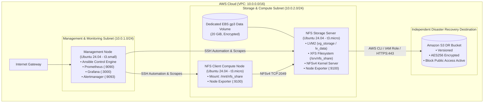
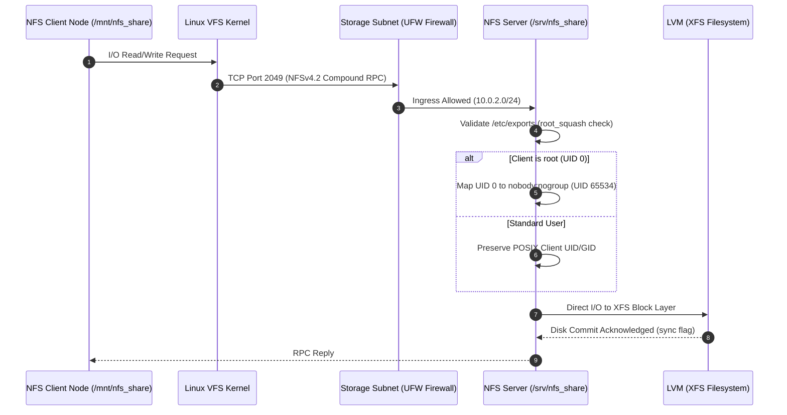
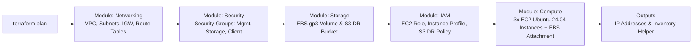
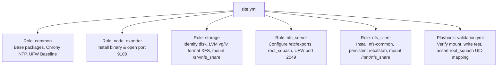
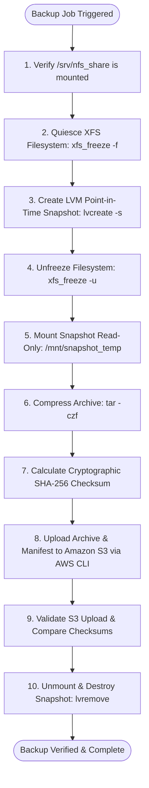
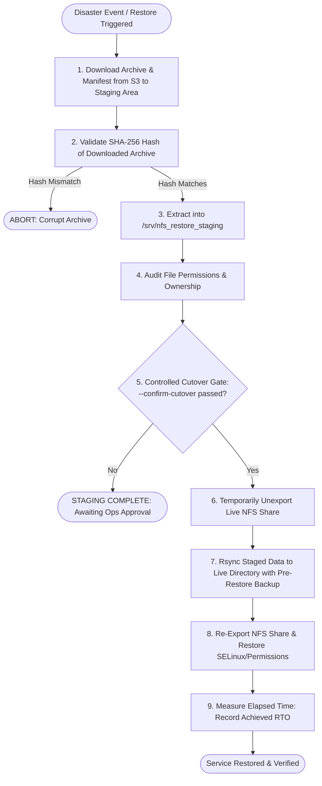
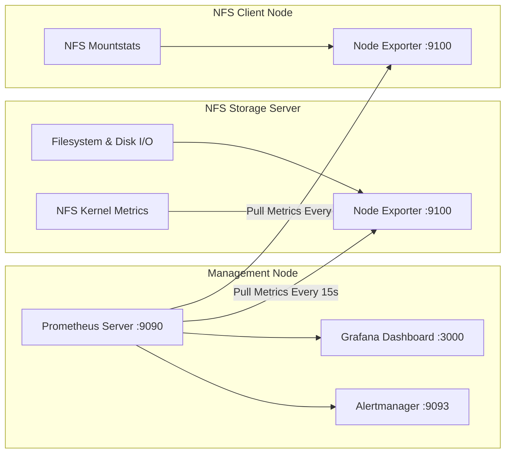
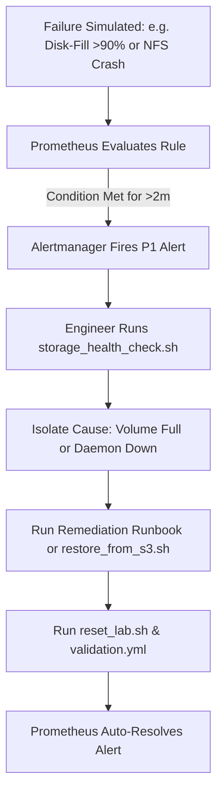

# Technical Architecture Specification: Enterprise Storage Service Lifecycle & Disaster Recovery Lab

## 1. Executive Summary

This architecture implements a centralized, enterprise-grade Linux shared storage service hosted on AWS, running on Ubuntu Server 24.04 LTS. It demonstrates the complete storage service lifecycle: infrastructure provisioning with Terraform, configuration automation via Ansible, secure multi-client NFSv4 access, disaster recovery with LVM snapshots and Amazon S3, and end-to-end observability using Prometheus and Grafana.

---

## 2. Mermaid Architecture Diagrams

### 2.1 Overall AWS Cloud Infrastructure

### 2.2 NFS Client-to-Server Communication Flow

### 2.3 Terraform Provisioning Flow

### 2.4 Ansible Configuration Pipeline

### 2.5 Backup-to-S3 Disaster Recovery Workflow

### 2.6 Disaster Recovery Staged Restore Workflow

### 2.7 Observability & Metric Scraping Architecture

### 2.8 Failure Detection and Incident Response Workflow

---

## 3. Network & Security Design

1. **Subnet Segmentation:**
   * `Management Subnet (10.0.1.0/24)`: Houses monitoring and operational tooling.
   * `Storage Subnet (10.0.2.0/24)`: Dedicated to data traffic between compute clients and storage servers.
2. **Security Groups:**
   * Port 2049 (NFSv4) is strictly restricted to internal subnets.
   * Management ports (22, 3000, 9090) are constrained to approved administrative ingress CIDRs.
   * Port 9100 (Node Exporter) is strictly restricted to the Management subnet.
3. **IAM Role Separation & Least Privilege:**
   * No static AWS access keys are deployed to instances. Roles are strictly decoupled per node responsibility:
     * **Management Node:** Scoped strictly to AWS Systems Manager (`AmazonSSMManagedInstanceCore`).
     * **Client Node:** Scoped strictly to AWS Systems Manager (`AmazonSSMManagedInstanceCore`).
     * **NFS Storage Server:** Scoped to SSM Core plus a dedicated least-privilege S3 policy (`s3:PutObject`, `s3:GetObject`, `s3:ListBucket`). `s3:DeleteObject` is intentionally omitted for immutable ransomware defense.
4. **DevSecOps Root Squashing & Mount Hardening:**
   * By default, client-side root accounts are squashed to `nobody:nogroup` on Ubuntu 24.04, neutralizing remote privilege escalation threats. Client mounts enforce `hard,timeo=600,retrans=2` to ensure write integrity.
5. **Access Architecture (Option B - Restricted SSH + SSM):**
   * Ansible configuration automation runs from the Management Node (`10.0.1.10`) targeting private Storage (`10.0.2.10`) and Client (`10.0.2.20`) nodes over internal SSH (port 22). Security groups restrict port 22 on private instances exclusively to `management_sg`.
   * Out-of-band administrative access is retained via AWS Systems Manager (`AmazonSSMManagedInstanceCore` on all three IAM roles).
6. **Private Subnet Connectivity & S3 Gateway VPC Endpoint:**
   * Storage and Client nodes reside in private subnets. S3 backup and restore operations traverse an AWS Gateway VPC Endpoint (`com.amazonaws.<region>.s3`) associated with the VPC route table at zero cost, never traversing the public internet.
   * In a temporary lab environment, to avoid AWS NAT Gateway ($32+/mo) and SSM Interface Endpoint ($21+/mo) costs, `assign_public_ip_to_storage` can be toggled to `true` during bootstrap to allow outbound package updates (`apt-get`) and direct SSM Session Manager access. In both modes, inbound security groups block all unauthorized traffic.
7. **Consistency Boundaries (Filesystem vs. Application):**
   * LVM snapshotting with `xfs_freeze -f` guarantees **Filesystem-Level Consistency** (VFS journal flushed, dirty blocks written). It does NOT guarantee **Application-Level Consistency** for active ACID databases (e.g. MySQL, PostgreSQL) unless application quiescing hooks (`FLUSH TABLES WITH READ LOCK`) are executed prior to freeze.
